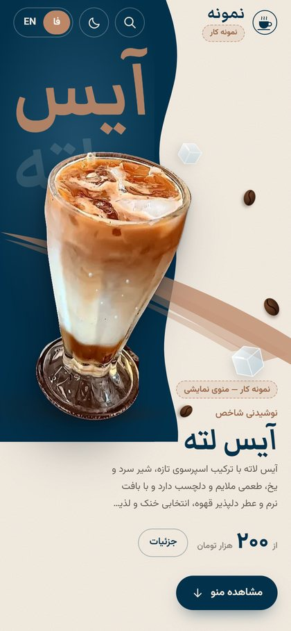
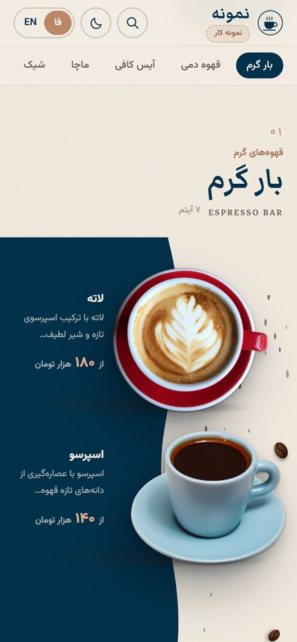
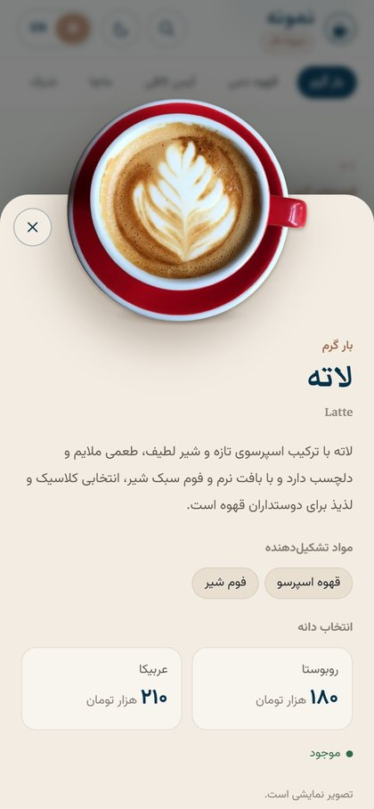
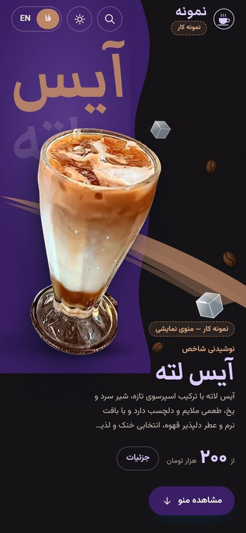
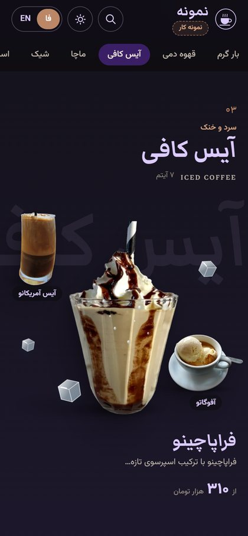
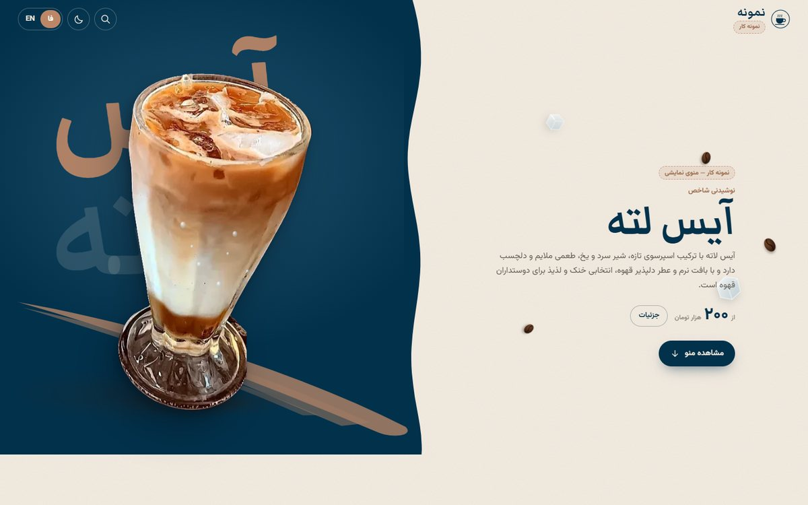

<div dir="rtl">

# منوی دیجیتال QR کافه — نمونه کار

منوی آنلاینی که مشتری با اسکن QR روی میز باز می‌کند؛ طراحی‌شده مثل یک پوستر تبلیغاتی قهوه، نه یک فروشگاه اینترنتی.
محصولات با سایه و عمق واقعی از صفحه «بیرون می‌زنند».

> این یک **نمونه کار** است. نام کافه («نمونه»)، قیمت‌ها و اطلاعات تماس نمایشی‌اند.

**🔗 دموی زنده:** https://ye8754467545-ship-it.github.io/coffee-menu-demo/

<p align="center">
  
  
  
</p>
<p align="center">
  
  
</p>
<p align="center"></p>

## امکانات

- طراحی موبایل‌محور با نسخه‌ی بازتر برای دسکتاپ
- ترکیب‌بندی متفاوت برای هر دسته: پنل موج‌دار، صحنه‌ی تک‌محصول، چیدمان دوتایی، بشقاب بزرگ
- سایه‌های چندلایه، پارالاکس ملایم، انیمیشن ورود و چرخش ظریف با ماوس (سازگار با «کاهش حرکت» سیستم)
- ۲۰ دسته و ۹۶ محصول با قیمت، مواد تشکیل‌دهنده و قیمت جداگانه برای دانه‌ی روبوستا/عربیکا
- جست‌وجو با نام فارسی، انگلیسی و مواد
- پنجره‌ی جزئیات محصول که از پایین باز می‌شود (بستن با کشیدن، Esc یا دکمه‌ی Back گوشی)
- دو زبان فارسی و انگلیسی با پشتیبانی کامل راست‌به‌چپ و چپ‌به‌راست
- حالت روز و شب (پیروی از تنظیم گوشی + ذخیره‌ی انتخاب کاربر)
- QR Code داخلی که به آدرس منو اشاره می‌کند
- فونت‌ها و تصاویر روی خود سایت (بدون وابستگی به CDN خارجی)

## اجرا

```bash
npm install
npm run dev      # http://localhost:5173
npm run build    # خروجی در dist/
```

با هر push روی شاخه‌ی `main`، سایت به‌صورت خودکار روی GitHub Pages منتشر می‌شود
(`.github/workflows/deploy.yml`؛ در تنظیمات ریپو: Settings → Pages → Source: **GitHub Actions**).

## شخصی‌سازی برای یک کافه

| فایل | محتوا |
| --- | --- |
| `src/config.js` | نام، نشانی، تلفن، ساعت کاری، اینستاگرام، واحد قیمت، آدرس نهایی QR |
| `src/components/Logo.jsx` | آرم |
| `src/data/products.json` | محصولات و قیمت‌ها |
| `src/data/categories.js` | ترتیب دسته‌ها، چیدمان هر بخش و تصویر هر محصول |
| `src/assets/products/` | تصاویر محصولات (webp با پس‌زمینه شفاف) |
| `src/styles.css` | رنگ‌ها؛ حالت شب زیر `:root[data-theme='dark']` |

## تکنولوژی

React · Vite · CSS خالص (بدون کتابخانه‌ی انیمیشن) · qrcode

## تصاویر

عکس‌ها از Wikimedia Commons با مجوزهای آزاد (CC0، CC BY، CC BY-SA، مالکیت عمومی) هستند و پس‌زمینه‌شان حذف شده است.
نام عکاس و مجوز هر عکس در `src/data/image-credits.json` و در فوتر سایت («منبع تصاویر») آمده است.

</div>

---

**English:** A mobile-first QR café menu built as a portfolio piece — React + Vite, bilingual (Persian RTL / English LTR), light and dark themes, search, product detail sheet and a built-in QR code. The café name, prices and contact details are placeholders. Photos are from Wikimedia Commons under free licences; see `src/data/image-credits.json`.
